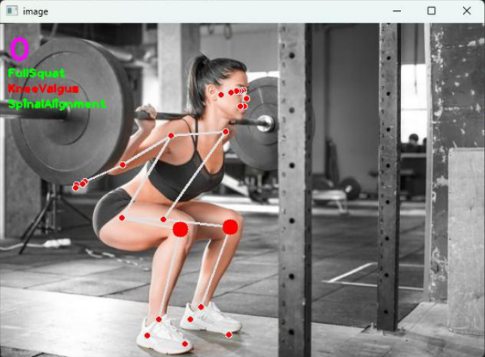

## 🛠 Tech Stack

### Main

### Sub

### Tools

---

## 🏆 Achievements

- **경희대학교 KhuThon 최우수상** (2017.11)
  - **스마트 학생증** · 모바일 예약·QR 출입 데모

- **전자정보대학 SW페스티벌 인기상** (2017.12)
  - **청각장애인용 IoT 알림등** · 미러볼 시각 알림

---

## 🧑‍💻 About Me

- 🎓 **경희대학교** 컴퓨터공학과 졸업 (2025.02)
- 🚀 **삼성 청년 SW·AI 아카데미(SSAFY) 16기** (2026.07 입과)

---

## 📜 Certifications

- ✅ **ADsP** · 데이터분석 준전문가 (2026.11.20 취득)
- 🗣️ **OPIc IH** · 영어 (2026.11.21 시험)

---

## 🚀 Projects

## 📷 [Urination Detector](https://github.com/ZANDHIFORCE/UrinationDetector)

**카메라 이미지 수집·라벨링·추론을 연결한 탐지 시스템**

---

## 🏋️ [AI Trainer](https://github.com/ZANDHIFORCE/AITrainer)

**운동 사진을 분석해 자세와 운동 가이드를 제공하는 웹 서비스**

