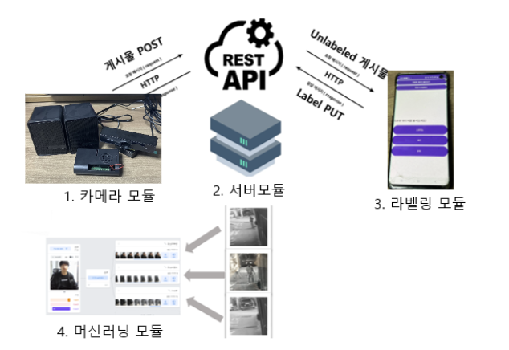
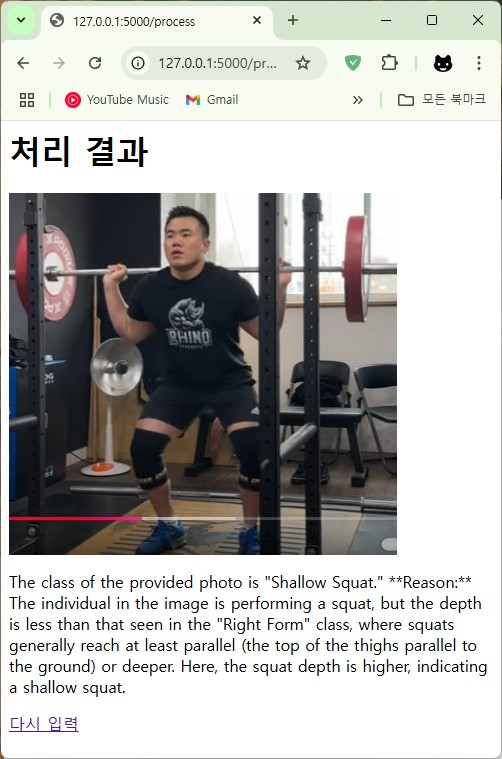

## 🛠 Tech Stack

### Main

### Sub

### Tools

---

## 🏆 Achievements

- **경희대학교 KhuThon 최우수상** (2017.11)
  - **스마트 학생증** · 모바일 예약·QR 출입 데모

- **전자정보대학 SW페스티벌 인기상** (2017.12)
  - **청각장애인용 IoT 알림등** · 미러볼 시각 알림

---

## 🧑‍💻 About Me

- 🎓 **경희대학교** 컴퓨터공학과 졸업 (2025.02)
- 🚀 **삼성 청년 SW·AI 아카데미(SSAFY) 16기** (2026.07 입과)

---

## 📜 Certifications

- ✅ **ADsP** · 데이터분석 준전문가 (2026.11.20 취득)
- 🗣️ **OPIc IH** · 영어 (2026.11.21 시험)

---

🔎 기술을 사용한 경험

| 관심 영역 | 프로젝트에서의 적용 |
| :--- | :--- |
| 백엔드 구조 | Controller·Service·Repository 역할 분리, 저장소 인터페이스 |
| 인증과 데이터 | 세션·JWT 인증, JDBC 검색, 이력 관리 |
| 외부 서비스 연결 | AI API 호출, 이미지 업로드·라벨링 API, 앱·장치 연동 |
| 검증 | 서비스·저장소·컨트롤러 테스트와 프로젝트별 재현 조건 기록 |

각 저장소의 README에 담당 범위, 구현 근거, 실행 조건과 현재 한계를 정리하고 있습니다.

---

##Projects

### 📷 Urination Detector

**카메라 이미지 수집·라벨링·추론을 연결한 탐지 시스템**

`Python` `Django` `Android / Java` `Keras`

[저장소 보기 ↗](https://github.com/ZANDHIFORCE/UrinationDetector)

---

### 🏋️ AI Trainer

**운동 사진을 분석해 자세와 운동 가이드를 제공하는 웹 서비스**

`Python` `Flask` `OpenAI API`

[저장소 보기 ↗](https://github.com/ZANDHIFORCE/AITrainer)
